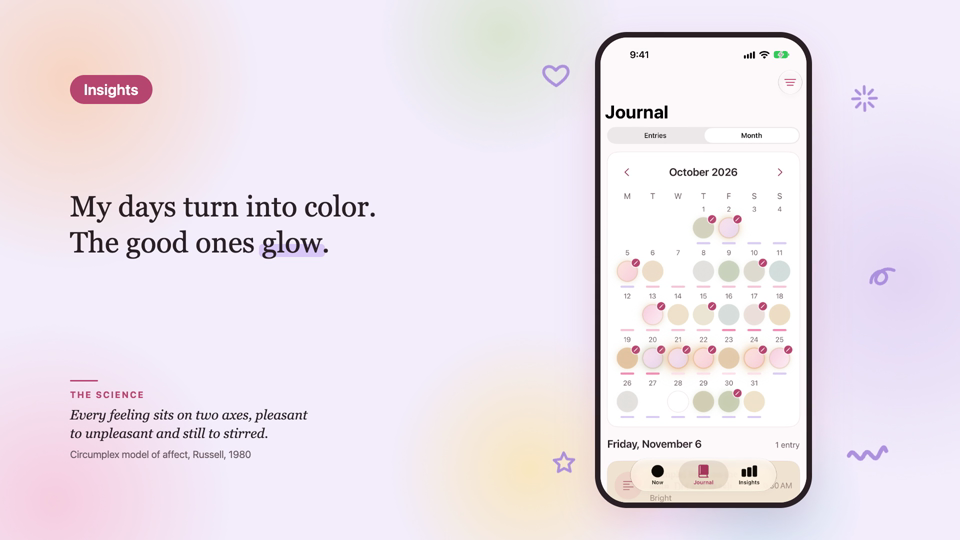
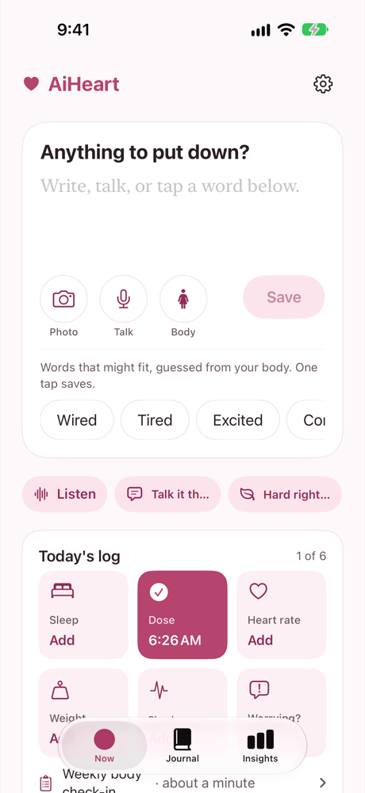
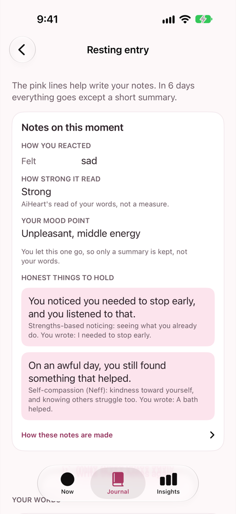
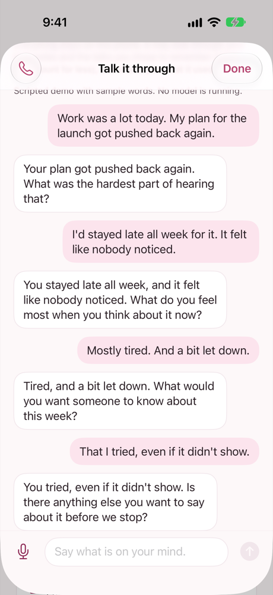
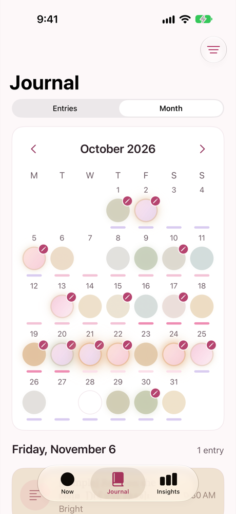
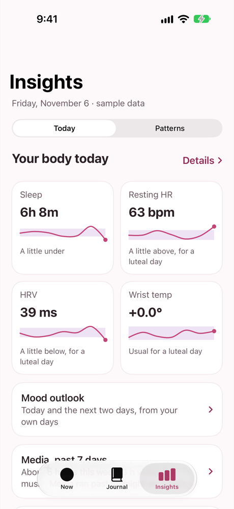
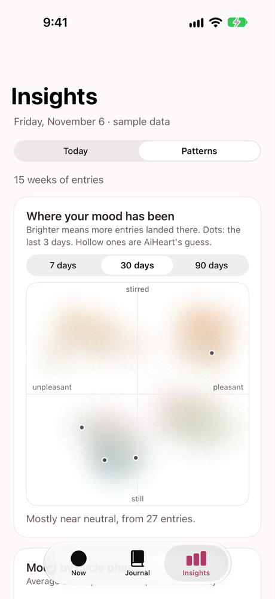
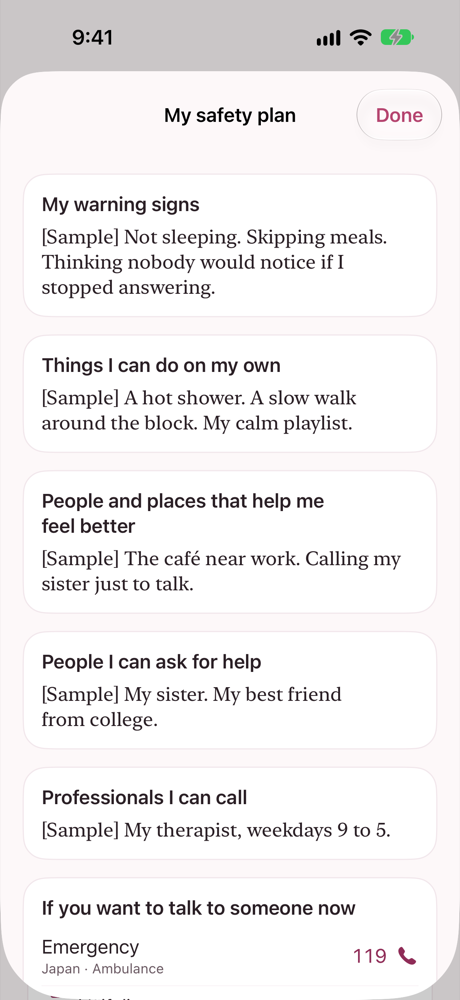
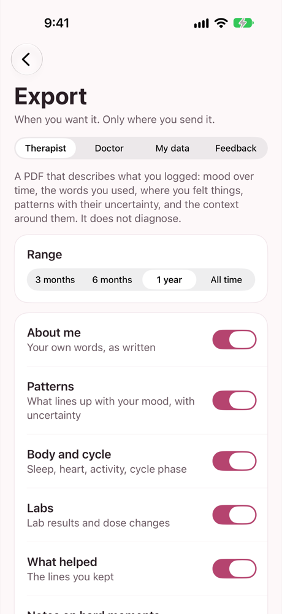

# AiHeart

A private iPhone journal that learns from my own body: mood, sleep, cycle, labs, training and media in one place. The data and the AI stay on the phone by default. An optional cloud model for text features is off by default.

I built it for myself, as a data scientist who wanted to manage my moods better: not to fix them, just to understand them, and to see how my body and my mood move together without handing that data to anyone. It helps me process what I feel. It describes what is happening and never tells me what to do.

**Film (2:24):** what the app does and the research behind each part. Screens are from the app on sample data. The Talk it through conversation is scripted with made-up words and labeled so on screen. The music is generated, not licensed.

  
  
  
  
  

  
  
  
  

*Screenshots use the app's built-in sample data.*

## What it does

**Capture, in a few taps**
- Write, talk, add a photo, tap a feeling word, or mark where you feel it on a body map.
- Today's log: sleep, medication dose, heart rate, weight and blood pressure as one-tap tiles (no watch needed).
- Weekly body check-in, and lab results read from a screenshot of the report (English and Japanese, on device).

**Insights from my own data, not population norms**
- Body signals against my own 28-day baseline, matched to cycle phase once there are enough cycles.
- Patterns with honest uncertainty: mood by cycle phase, sleep and the next day, activity and mood, a density map of where my mood has been.
- Mood outlook: a small ridge model per day ahead, shown as a lean with an uncertainty band. It says "Not yet" until it beats two naive baselines (same as yesterday, 7-day mean) in a rolling backtest.
- Labs: lab history with the lab's own ranges, dose changes, and what I noticed between tests.

**A journal that colors itself**
- Each entry takes a color from where it sits on a pleasant/unpleasant and still/stirred plane. The calendar glows brighter on good days.
- Entries without a feeling get a tone guess from the language model (on the phone, or the cloud model if switched on), used only for color.
- Moment notes: each entry gets a short note built on the five-part model from cognitive behavioural therapy: what happened in one neutral line, then what I thought, felt, noticed in my body and did, plus feelings and needs picked from fixed lists, each backed by my own words.
- Honest things to hold: one or two short lines written by the language model that connect things I actually wrote. Each line shows the sentence it rests on and the approach behind it (self-affirmation, self-compassion, strengths, affect labelling). Fixed rules check every line: no praise of who I am, no promises, no advice, nothing I did not write. A line that fails is dropped, and fixed templates are the fallback.
- Keep or release: hard entries can be let go, keeping only a summary note (what happened, feelings, how strong, what was needed) and never my exact lines. While an entry rests, its notes can be written again. Deleted entries wait 30 days in Recently deleted. Entries about self-harm are always kept and open a safety page.

**Listen**
- When words won't come: talk or type, and it mostly listens. Speech is transcribed on the phone. No persona, no advice, no memory between sessions.

**Talk it through**
- A reflective conversation I start when I want to think a hard moment through, in a warm voice. It can search my own notes and, if I choose "Remember it", my own words from earlier talks (older ones count for less). It never gives a diagnosis or a promise, and a fixed safety card shows when something reads as heavy.
- Uses the cloud model if I switched it on (see Privacy), otherwise the on-device one.

**Safety plan**
- My own plan in the six steps of the Stanley-Brown Safety Planning Intervention: warning signs, things I can do alone, people and places that help, people I can ask, professionals I can call, and making my space safer. People can be added from Contacts.
- Crisis lines for Japan and the Philippines under the professionals step. One tap away from the toolbar, and opened automatically on entries about self-harm.

**Media**
- Spotify (live), Netflix and YouTube history, shown as the week's hours, late nights and what's on repeat, plus a short "vibe" written on the phone from titles, genres and lyrics.

**Out, on my terms**
- PDF reports for a therapist and a doctor, made on the phone and shared only where I send them (they describe what I logged and do not diagnose), a "My data" report with charts and tables, a spreadsheet export, and a passphrase-locked backup with restore.
- A few fixed red-flag rules (very high blood pressure, very fast or slow heart rate, chest pain and similar) show the local emergency number. Nothing else is medical advice.

## The science behind it

Each design choice is checked against published research, and the limits are written down. Full notes, strength ratings and what was and was not verified: [`docs/12-evidence.md`](docs/12-evidence.md).

| Feature | What it rests on | Strength |
|---|---|---|
| Moment notes | The five-part model of a reaction used in CBT (Padesky and Mooney 1990; Greenberger and Padesky, *Mind Over Mood*) | Moderate as a clinical structure |
| Feeling words, Listen | Putting feelings into words lowered amygdala response (Lieberman et al. 2007) | Limited to moderate |
| Body map | People map emotions onto the body in consistent patterns across cultures (Nummenmaa et al. 2014) | Moderate (lab) |
| Mood colors | Valence and arousal, the two-dimensional model of affect (Russell 1980) | Moderate |
| Let go | Physically discarding a written thought reduced its influence (Briñol et al. 2013) | Limited |
| Honest things to hold | Self-affirmation (Cohen and Sherman) and self-compassion (Neff), as named on each line | Not yet rated in docs/12 |
| Talk it through never just agrees | One sycophantic AI reply made people more sure they were right and less willing to repair a conflict (Cheng et al., *Science* 2026) | Moderate |
| Cycle-matched baselines | Heart rate variability falls from the follicular to the luteal phase (meta-analysis of 37 studies) | Moderate to strong |
| Sleep in the outlook | Sleep loss is a commonly reported trigger of mood episodes (n = 3,140) | Moderate |
| Training and mood charts | Resistance training reduced depressive symptoms across 33 trials (Gordon et al. 2018) | Moderate |
| Safety plan | Safety Planning Intervention (Stanley and Brown 2012); fewer suicidal behaviours with a plan and follow-up (Stanley et al. 2018) | Moderate |

Where the evidence is thin, the app says so: the mood outlook is a hypothesis tested against simple baselines, inferring needs from diary text has no research behind it, and automatic let-go is the least evidence-based feature. Most sources were read as abstracts.

## Privacy by design

**Tier 1: on the phone, by default**
- No servers, no analytics, no accounts. Data lives in an encrypted SwiftData store on the phone.
- The language model (Qwen3-VL 4B, 4-bit, via MLX) runs on the device and does all the work unless I switch the cloud model on. Nothing leaves the phone.
- Every model output is checked before it is shown: no diagnoses, labels, advice or reassurance, and every number must come from the app's own calculations.
- Other network calls only fetch data in: Apple Health is local; Hevy, Spotify and a lyrics lookup send only what they need, each behind a switch.

**Tier 2: an optional cloud model, off by default**
- A switch in Language model, with my own OpenRouter key stored in the Keychain.
- When on, it handles the text features: moment notes, Talk it through, Outlook, tone guesses, word suggestions, About me proposals, keep-or-release checks and Listen replies. With it off, the on-device model or fixed rules do the work.
- Names, places, organisations, emails, phone numbers, links, handles and long numbers are replaced on the phone before sending and restored on the phone after. Redaction is not perfect: it can miss an unusual name or a nickname.
- Requests ask providers not to store or train on them (`data_collection: deny`).
- Photos, photo and vibe captions, and media (Spotify, Netflix, YouTube) are never sent. Text that mentions self-harm is checked on the phone first and never sent.
- Details: `docs/20-cloud-model.md`.

## How it is built

- SwiftUI, SwiftData, Swift Charts, HealthKit, Vision, Speech, App Intents, iOS 26+.
- `Packages/AiHeartCore`: models, statistics, the outlook, parsers, export and backup, with about 500 unit tests on synthetic data.
- `App/`: the iPhone app.
- `docs/`: the product spec, data model, analytics, privacy rules and the research behind the design. `CLAUDE.md` holds the non-negotiable rules the app was built against.
- Built milestone by milestone with Claude Code.

## Building

1. Install [XcodeGen](https://github.com/yonaskolb/XcodeGen).
2. Create `Config/Local.xcconfig` with your Apple team: `DEVELOPMENT_TEAM = YOURTEAMID`.
3. Run `xcodegen generate` and open `AiHeart.xcodeproj`.
4. To try it without your own data, add `-seedSamples` to the scheme's launch arguments.

This is a personal project, not an App Store product, and not a medical device.
